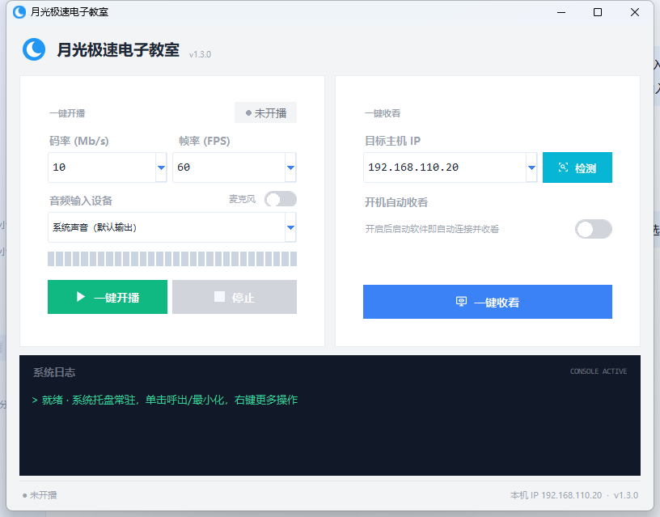
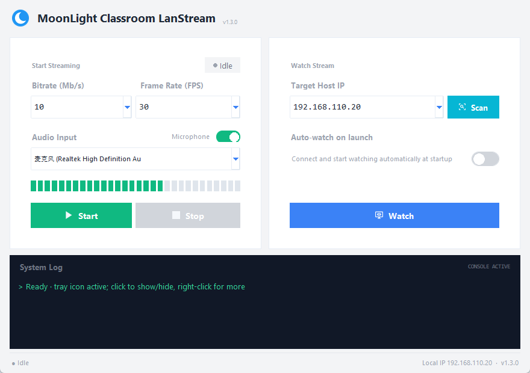

# 月光极速电子教室（MoonClass LanStream）

**简体中文** ｜ [English](#english)

> 面向机房的**一键局域网串流**教学软件：教师机点「一键开播」，学生机点「一键收看」，
> 数秒内看到教师屏幕。内置 **Sunshine（服务端）+ Moonlight（客户端）**，单个 EXE，双击即用，无需安装。



---

## 这是什么

基于开源 [Sunshine](https://github.com/LizardByte/Sunshine)（服务端）与
[Moonlight](https://github.com/moonlight-stream/moonlight-qt)（客户端）二次开发的桌面程序，
把原本需要手工配置的「配对 / 防火墙 / 编码参数 / 多客户端」流程全部自动化，
面向局域网教学场景做了取舍：**低延迟优先、局域网明文串流、免手工配对**。

- 仓库内提供两套等价实现：**C# 版（`windows/`，当前主推，单文件 EXE，运行时已内嵌）**
  与 **Python 版（根目录，历史版本，源码可读性好）**，两者共用同一套配置与运行时目录
- 已修复/规避以下常见坑：`bind_address` 导致 502、`-0` 参数导致配对会话 408、
  `PIPE` 未读取导致配对进程阻塞、证书与私钥不匹配导致 mTLS 失败、PyInstaller 下托盘句柄无效、
  独占全屏被系统关闭导致“刚连上就闪退”、按注册表主机名判断配对状态导致反复重配重连等

**当前版本：v1.3.4**（更新记录见 [CHANGELOG.md](CHANGELOG.md)）

---

## 功能特性

### 开播（教师机）
| 功能 | 说明 |
|---|---|
| 一键开播 | 自动停掉系统 Sunshine 服务 → 写入优化配置 → 启动服务端 → 放行防火墙 |
| 码率 / 帧率设置 | 下拉可选，也可手动输入，默认 **10 Mb/s + 60 FPS**，自动写入配置文件 |
| 状态指示 | ● 未开播 / ● 已开播 / ● 正在直播（按真实端口与活动连接判断） |
| 开播进度条 | 状态栏实时显示开播阶段与百分比（检查环境 → 写配置 → 同步证书 → 放行端口 → 启动服务端 → 等待就绪） |
| 客户端计数 | 开播后状态栏实时显示「已连接 N 台客户端」（按 Sunshine 会话日志统计，连上/断开 1~2 秒内刷新） |
| 音频串流 | 默认串流**系统声音**（课件/视频声），可选音频输入设备 |
| 麦克风混入 | 开关默认**开启**；教师麦克风的声音走独立 UDP 通道直达学生端，教师机本地**不外放、无回声** |
| 音频电平指示 | 横向分段电平条（绿/黄/红），随时确认麦克风"有没有输入" |

### 收看（学生机）
| 功能 | 说明 |
|---|---|
| 一键收看 | 自动配对（固定 PIN `0000`，无需人工输入）→ 直接进入画面 |
| 目标主机 | IP 输入框支持手动输入 + 下拉历史（自动记忆上次检测到的主机） |
| 一键检测 | 扫描局域网内已开播主机，加入下拉列表 |
| 开机自动收看 | 开关默认关闭，开启后启动软件即自动连接并收看，设置写入配置文件 |
| 断线自愈 | 收看中 Moonlight 意外退出会自动重连（失败按 8/16/30 s 递增退避，不会刷屏重试） |
| 随开播/停播自动进出 | 教师端开播即自动进入收看；教师端停播（或发出停播信令）立即退出 Moonlight 并继续监听，下次开播再自动进入 |
| 麦克风收听 | 接收教师端麦克风 UDP 音频流，只在收看期间播放，退出收看立即静音 |

### 通用
- **中英双语界面**：自动跟随系统语言（中文系统显示中文，其他语言显示英文），无需设置
- **系统托盘常驻**：单击呼出/最小化，右键菜单（开播/停止/收看/退出）
- **单实例运行**：重复打开不会启动第二份，而是把已运行窗口弹到最前
- **后台无弹窗**：开播与配对过程全程无命令行黑框、无 Moonlight 配对窗口，只有连接成功才出现画面
- **设置全部持久化**：主机、历史主机、码率、帧率、开机自动收看均写入配置文件
- 极简扁平 UI：直角卡片 / 按钮，日志区 + 状态栏

---

## 两个版本

仓库提供两套等价实现，功能与数据目录完全互通（共用 `%LOCALAPPDATA%\LanStream`，
包括已释放的运行时与 `lanstream_state.json`），任选其一使用：

| 版本 | 技术栈 | 主程序体积 | 说明 |
|---|---|---|---|
| **C# 版**（`windows/`，**当前主推**） | .NET Framework 4.8 + WinForms，纯代码自绘 | 单文件 73 MB（运行时已内嵌，首次运行释放） | 系统自带 .NET Framework，无需安装任何依赖；启动更快、体积比 Python 版小 |
| **Python 版**（根目录，历史版本） | Python 3.12 + tkinter，PyInstaller 单文件 | 93.7 MB（含 72 MB 运行时） | 保留作参考实现，功能与本版一致但已不再更新 |

C# 版已在 **VS 2022 Build Tools 17.14 + .NET Framework 4.8 目标包**下编译通过并实测
（启动 1.0 s 左右、开播 2 s 左右、客户端计数 1~2 s 内刷新，单实例 / 停止 / 中英文界面均正常），
编译方式见 [windows/README.md](windows/README.md)。

---

## 音频

开播卡片下半部分是音频设置，**画质（码率/帧率）在上、音频在下**：

| 控件 | 说明 |
|---|---|
| 音频输入设备 | 下拉选择录音设备；首项「系统声音（默认输出）」表示只串流系统声音，不采集麦克风 |
| 麦克风 开关 | 开启（默认）= 把所选麦克风的实时声音发给学生端；关闭 = 只串流系统声音 |
| 电平条 | 横向 30 段指示器（绿→黄→红），有输入就亮，用来确认麦克风是否正常工作；关麦即停采集并归零 |

实现说明（v1.3.1 起）：Sunshine 只捕获**系统播放设备**（WASAPI loopback），其协议在 Windows 上
没有可用的 Mic 通道，因此麦克风走**独立 UDP 通道**（自定义 `LMS1` 音频块，端口 `48050`）：
教师端广播 + 学生端心跳订阅后改为单播，学生端只在收看期间播放。教师机本地不再把麦克风回放
到扬声器，所以**不会有自己的声音从音响里传出来**，也不需要系统「侦听此设备」。

> 设备名长度不受 winmm 的 32 字符限制：下拉列表读注册表 `MMDevices\Audio\Capture` 拿完整名称。

---

## 界面语言

界面文字**自动跟随系统语言**，无需任何设置：

| 系统语言 | 界面语言 | 主字体 |
|---|---|---|
| 简体中文 / 繁体中文 / 中国香港 / 中国澳门 | 中文 | Microsoft YaHei UI |
| 其他所有语言 | English | Segoe UI |

开发或演示时可临时强制指定语言（环境变量优先级最高）：

```powershell
$env:LANSTREAM_LANG="en"   # en = 英文，zh = 中文
python lanstream_app.py
```

文案集中在 `i18n.py`，新增语言只需在 `_T` 字典里补一列并扩展 `_detect()`。

---

## 系统要求

- **Windows 10 / 11**（x64）
- 教师机建议带硬件编码能力的 GPU（NVIDIA NVENC / AMD AMF / Intel QSV；默认配置优先使用 NVENC）
- 学生机无需任何额外安装
- 首次运行会请求一次管理员权限（用于接管 Sunshine 服务与开放防火墙端口）

---

## 快速开始

1. 运行 `月光极速电子教室-vX.Y.Z.exe`
2. 教师机点 **「一键开播」**，状态栏变为 `● 已开播`
3. 学生机在「目标主机 IP」填教师机 IP（或点「检测」自动发现），点 **「一键收看」**

> 教师机「本机 IP」与状态栏右下角都会显示本机地址，可直接口播给学生。

---

## 从源码构建

### C# 版（推荐）

```powershell
# 依赖：VS 2022 Build Tools + .NET Framework 4.8 目标包（详见 windows\README.md）
cd windows
powershell -ExecutionPolicy Bypass -File .\build.ps1 -Version 1.3.4
```

产物：`dist\月光极速电子教室-v1.3.4.exe`（约 73 MB，运行时已内嵌；`-SkipSign` 可跳过代码签名，
签名脚本会自动创建/复用本机自签证书）。`build.ps1` 需要 `Resources\runtimes.zip` 存在才会内嵌
运行时，缺失时只产出不带运行时的 exe。

### Python 版（历史版本）

```powershell
# 1) 依赖（Python 3.12 x64，必须带 Tcl/Tk；pywin32 用于托盘与窗口操作）
winget install --id Python.Python.3.12 --scope user
python -m pip install pyinstaller pillow pywin32

# 2) 准备运行时：本机需已安装 Sunshine 与 Moonlight（默认路径见 make_runtimes.py），
#    把它们打包成 runtimes.zip（sunshine/ + client/）
python make_runtimes.py

# 3) 一键构建（生成图标 → 打包运行时 → PyInstaller 单文件）
powershell -ExecutionPolicy Bypass -File .\build_exe.ps1 -Version 1.3.0
```

产物：`dist\月光极速电子教室-v1.3.0.exe`

**注意**：`runtimes.zip`（约 72 MB）不随仓库分发，需由 `make_runtimes.py` 从本机已安装的
Sunshine / Moonlight 生成。为压小包体，打包时会剔除两类运行期用不到的文件：
`sunshine/tools/`（`dxgi-info.exe` 57 MB 显卡诊断工具、`audio-info.exe`、`sunshinesvc.exe`）
与 Moonlight 的 33 种 Qt 翻译（只留英文），合计省下约 26 MB。仓库**不包含任何私钥/证书**：
首次开播时 Sunshine 会在 `%LOCALAPPDATA%\LanStream\config\credentials\` 自动生成一套本机证书，
每台机器独立。

源码运行（调试）：`python lanstream_app.py`。

---

## 配置文件

运行时数据目录：

- 打包版：`%LOCALAPPDATA%\LanStream\`
- 源码运行：项目下 `.runtime\`

| 文件 | 用途 |
|---|---|
| `lanstream_state.json` | 界面全部设置（目标主机、主机历史、码率、帧率、开机自动收看、麦克风、音频设备） |
| `config\sunshine.conf` | 每次开播时按界面设置生成的 Sunshine 配置 |
| `config\sunshine_state.json` | Sunshine 自身状态（含已配对设备 `named_devices`、Web 凭据） |
| `sunshine.log` | 服务端日志（排查开播问题先看这里） |
| `moonlight.log` | 学生端日志：配对检查结论、Moonlight 命令行、实时 stdout/stderr、退出码 |
| `gui.log` | 界面日志（仅当设置环境变量 `LANSTREAM_LOG=1` 时写入，便于无界面排查） |
| `startup.log` | 启动与运行时释放耗时 |

`lanstream_state.json` 主要字段：

```json
{
  "host": "192.168.1.100",
  "hosts": ["192.168.1.100", "192.168.1.101"],
  "bitrate_mbps": 10.0,
  "bitrate": 10000,
  "fps": 60,
  "autowatch": false,
  "mic": true,
  "audio_device": ""
}
```

### 端口

| 端口 | 协议 | 用途 |
|---|---|---|
| 47989 | TCP | 控制 / serverinfo（HTTP 入口） |
| 47984 | TCP | 配对与 applist（HTTPS） |
| 47990 | TCP | Sunshine Web 管理页 |
| 48010 | TCP/UDP | 串流数据 |
| 48050 | UDP | 麦克风音频（`LMS1`）、收看订阅心跳（`LMSJ`）、停播信令（`LMSQ`） |

开播时程序会自动为以上端口添加防火墙入站规则（仅私有/域网络）。

---

## 目录结构

```
# ---- C# 版（当前主推）----
windows/
  MainForm.cs           # 主界面：开播/停止/收看、自动跟随、状态轮询（探活在后台线程）
  SunCore.cs            # Sunshine 配置生成、启动/停止、局域网扫描、客户端计数
  ClientCore.cs         # Moonlight 配对与串流：配对检查(list)、启动串流、实时日志抓取
  MicAudio.cs           # 麦克风采集 + UDP 发送/接收 + 停播信令
  Runtime.cs            # 数据目录、运行时释放、版本、图标资源
  Settings.cs           # lanstream_state.json 读写
  I18n.cs / Ui.cs       # 中英文案、自绘控件（按钮/开关/电平条）
  TrayIcon.cs           # 系统托盘
  Resources/            # icon.ico、runtime_config、runtimes.zip（构建期生成，不入库）
  app.manifest          # 高 DPI + asInvoker（编译必需，勿删）
  build.ps1             # 一键构建 + 自签代码签名
  MoonClassLanStream.csproj
windows/README.md       # C# 版编译与实测说明

# ---- Python 版（历史版本）----
lanstream_app.py      # 主界面（tkinter）+ 单实例 + 进度条 + 托盘联动
lanstream_core.py     # 核心：Sunshine 配置/启动、配对、串流、防火墙、状态与客户端计数
lanstream_ui.py       # 系统托盘（Win32 原生，右键菜单带图标）
i18n.py               # 中英文案表与系统语言自动识别
icons.py              # 图标染色/缩放（MDI 矢量图标遮罩）
icon_data.py          # 图标 alpha 遮罩（base64，构建期由 SVG 栅格化生成）
icon.ico              # 应用/窗口/托盘图标
make_icon.py          # 生成 icon.ico
make_runtimes.py      # 把本机 Sunshine + Moonlight 打包成 runtimes.zip
build_exe.ps1         # 一键构建单文件 EXE
runtime_config/       # 基础配置（apps/凭据哈希）；证书在首次开播时由 Sunshine 自动生成
docs/screenshot.png   # 界面截图（中文 / 英文：docs/screenshot-en.png）
scratch/              # 开发期临时脚本（已 .gitignore，可随时删除）
```

---

## 常见问题

**Q：学生机点了收看，Moonlight 一闪就没了，然后一直重连？**
v1.3.4 修复了两个根因，先确认用的是 v1.3.4 及以上：

1. **配对状态判定**（主因）：旧版读注册表 `hosts\<n>\hostname` 与输入的 IP 比对，但 Moonlight 6.x
   在那里存的是**对方主机名**（如 `MoonClass-Room`），永远不相等 → 每次都判“未配对”，于是清空
   配对、重新配对（配对前还会 `taskkill Moonlight`），表现就是“刚连上就闪退、一直重连”。
   现在改回用 `moonlight list <host>` 判定（与 v1.2.0 相同）。
2. **独占全屏被系统关闭**：桌面锁屏 / 远程会话 / 无交互桌面时，`--display-mode fullscreen`
   会被系统 WM_CLOSE，Moonlight 优雅退出（退出码 0）。现固定使用 `borderless`（同样铺满全屏）。

仍然复现的话，看 `%LOCALAPPDATA%\LanStream\moonlight.log`：里面记录了配对检查结论、完整命令行、
实时 stdout/stderr 和退出码。

**Q：Moonlight 启动不起来，日志也是空的？**
v1.3.3 起运行时补齐了 VC++ 运行库（`vcruntime140.dll`、`msvcp140.dll` 等 8 个），并把 Moonlight
的输出**实时**落盘。旧版缺运行库时进程卡在 loader，只有退出后才写日志，所以看起来“没有日志”。

**Q：打开软件窗口就“未响应”？**
v1.3.3 起，状态轮询里的端口探活（最长 1.5 s）已移到后台线程，UI 线程不再被阻塞。
如果目标 IP 不通，界面仍可正常操作，只是自动收看会按 8/16/30 s 退避重试。

**Q：教师机开麦后，自己的声音从音响里出来了？**
v1.3.1 起麦克风不再回放到本机默认输出设备，而是走独立 UDP 通道（端口 `48050`）直达学生端，
教师机本地不会外放。

**Q：学生机一直停在“需要输入 PIN”？**
配对由教师机自动完成（固定 PIN `0000`）。请确认：教师机已开播、双方在同一局域网、
教师机防火墙已放行 47984-48010（点一次开播会自动添加规则）。

**Q：托盘图标找不到了？**
Windows 11 会把新图标的托盘项收进右下角 `^` 隐藏区，拖到任务栏即可常显。
关闭窗口只是最小化到托盘，可从托盘菜单「退出」真正结束程序。

**Q：开播后状态栏显示“已开播，等待学生端连接”？**
说明服务端已就绪但还没有客户端连接，属于正常待连状态；学生端连上后会显示「正在直播 · 已连接 N 台客户端」。

**Q：重复双击图标没反应？**
程序是单实例运行的：第二次打开会把已运行的窗口弹到最前，而不会启动第二份。

**Q：界面是英文，想改中文？**
界面语言跟随 Windows 系统语言（设置 → 时间和语言 → 语言）。中文系统会自动显示中文；
也可用 `LANSTREAM_LANG=zh` 环境变量强制指定。

**Q：想改默认码率/帧率？**
直接在「码率 (Mb/s)」「帧率 (FPS)」下拉或手动输入，开播/收看时生效并写入配置文件。

**Q：学生端能看画面但没声音？**
先在教师机确认系统声音正常外放（Sunshine 捕获的就是默认播放设备的 loopback）；
学生端若接的是蓝牙耳机，切换回有线/内置输出试试。要让学生听到老师讲话，
请把「麦克风」开关打开（建议教师机用耳麦，避免啸叫）。

**Q：状态栏的「已连接 N 台客户端」一直不变？**
v1.3.0 起改为读取 Sunshine 日志中的 `CLIENT CONNECTED` / `CLIENT DISCONNECTED` 事件，
客户端连上或断开后 1~2 秒内即刷新，同时日志区会打印「客户端连接数：N」。
旧版本按 TCP 连接数统计，而 Sunshine 串流视频走 UDP、控制连接是短连接，
采样时几乎只有 `TIME_WAIT`，导致数字恒为 0。

---

## 第三方组件

本项目在运行时**内嵌并调用**以下开源组件（仓库本身不重复分发其二进制）：

| 组件 | 用途 | 许可 |
|---|---|---|
| [Sunshine](https://github.com/LizardByte/Sunshine) | 串流服务端 | GPL-3.0 |
| [Moonlight](https://github.com/moonlight-stream/moonlight-qt) | 串流客户端 | GPL-3.0 |
| [Material Design Icons](https://materialdesignicons.com/) | 界面/菜单图标 | Apache-2.0 |
| [Pillow](https://python-pillow.org/) | 图像处理 | HPND |
| [pywin32](https://github.com/mhammond/pywin32) | Win32 托盘/窗口 | PSF-2.0 |

详见 [THIRD_PARTY.md](THIRD_PARTY.md)。

## 许可

本项目以 **GPL-3.0** 发布（见 [LICENSE](LICENSE)）。因其分发/捆绑了 GPL-3.0 的 Sunshine 与
Moonlight，整体分发须遵循 GPL-3.0；如需商用或闭源分发，请自行评估并遵守上游许可。

## 免责声明

本项目仅用于**自有设备的局域网屏幕共享与教学演示**。请勿用于未经授权的远程控制或屏幕采集；
使用者需自行确保符合所在学校/单位的信息安全规定及当地法律法规。

---
---

<a id="english"></a>

# MoonClass LanStream

**English** ｜ [简体中文](#月光极速电子教室moonclass-lanstream)

> **One-click LAN screen streaming** for computer classrooms: the teacher clicks **Start**,
> students click **Watch**, and the teacher's screen appears within seconds. Ships **Sunshine (server)
> + Moonlight (client)** inside a single EXE — double-click to run, nothing to install.



---

## What it is

A desktop app built on top of the open-source [Sunshine](https://github.com/LizardByte/Sunshine)
(streaming server) and [Moonlight](https://github.com/moonlight-stream/moonlight-qt) (streaming
client). It automates everything that normally needs manual setup — pairing, firewall rules,
encoder parameters, multiple clients — with deliberate trade-offs for classroom LAN use:
**latency first, unencrypted LAN streaming, no manual pairing.**

- Two equivalent implementations ship in this repo: the **C# edition (`windows/`, primary, single-file
  EXE with the runtimes embedded)** and the **Python edition (repo root, legacy reference)**. Both
  share the same config and runtime directory.
- Fixes/works around common pitfalls: `bind_address` causing HTTP 502, the `-0` flag breaking the
  pairing session (408), unread `PIPE` buffers blocking the pairing process, certificate/private-key
  mismatch breaking mTLS, invalid tray handles under PyInstaller, exclusive-fullscreen being closed by
  Windows (stream drops after a few seconds), and pairing state read from the registry hostname
  (causing endless re-pairing and reconnects)

**Current version: v1.3.4** (see [CHANGELOG.md](CHANGELOG.md))

---

## Features

### Streaming (teacher machine)
| Feature | Description |
|---|---|
| One-click start | Stops the system Sunshine service → writes optimized config → starts the server → opens firewall ports |
| Bitrate / FPS | Choose from the dropdown or type a value; defaults to **10 Mb/s + 60 FPS**, saved to the config file |
| Status indicator | ● Idle / ● Ready / ● Live (based on real port state and active connections) |
| Start progress bar | Shows the current stage and percentage in the status bar (check env → write config → sync certs → open ports → start server → wait for readiness) |
| Client counter | Status bar shows "N client(s) connected" while live (derived from the Sunshine session log, refreshed within 1-2 s of a client joining or leaving) |
| Audio streaming | Streams **system sound** (courseware / video audio) by default; the input device is selectable |
| Microphone mixing | On by default; the teacher's microphone is sent to students over a dedicated UDP channel, with **no local playback and no echo on the host** |
| Audio level meter | Horizontal segmented meter (green / yellow / red) to confirm the microphone actually has input |

### Watching (student machine)
| Feature | Description |
|---|---|
| One-click watch | Auto-pairs with a fixed PIN `0000` (no manual input) → goes straight to the video |
| Target host | Editable IP box with a dropdown history (remembers the last detected host) |
| Scan | Scans the LAN for hosts that are already streaming and adds them to the dropdown |
| Auto-watch on launch | Off by default; when enabled the app connects and starts watching at startup, saved to the config file |
| Self-healing reconnects | If Moonlight exits unexpectedly the app reconnects automatically (8/16/30 s back-off, no retry storm) |
| Follow start/stop | Joins automatically when the teacher starts streaming; exits Moonlight as soon as the teacher stops (or sends the stop signal) and keeps listening for the next session |
| Microphone playback | Receives the teacher's UDP microphone audio and plays it only while watching; muted instantly on exit |

### General
- **Bilingual UI**: follows the system language automatically (Chinese UI on Chinese Windows, English UI elsewhere) — no configuration needed
- **Tray resident**: click to show/hide, right-click for Start / Stop / Watch / Exit
- **Single instance**: launching again brings the existing window to the front instead of starting a second copy
- **No background windows**: neither starting nor pairing shows a console window or Moonlight dialog; video appears only after a successful connection
- **All settings persist**: target host, host history, bitrate, FPS and auto-watch are written to the config file
- Minimal flat UI: square cards and buttons, log panel plus status bar

---

## Audio

The lower half of the streaming card holds the audio settings — **video options (bitrate/FPS) on top,
audio below**:

| Control | Description |
|---|---|
| Audio Input | Choose a recording device; the first entry "System Sound (default output)" streams system audio only and captures no microphone |
| Microphone switch | On (default) = the selected microphone is sent to students in real time; Off = system sound only |
| Level meter | 30-segment horizontal meter (green → yellow → red) that lights up with input; turning the mic off stops capture and resets the meter |

How it works (since v1.3.1): Sunshine only captures the **system playback device** (WASAPI loopback) and
its protocol has no usable Mic channel on Windows. The microphone therefore uses a **dedicated UDP
channel** (custom `LMS1` audio blocks on port `48050`): the host broadcasts, and after a student's
`LMSJ` heartbeat it switches to unicast. Students play the audio only while watching. Nothing is played
back locally on the host, so **your own voice never comes out of the speakers** and Windows
"Listen to this device" is not needed.

---

## UI language

The interface follows the **system language** automatically — no setting required:

| System language | UI language | Primary font |
|---|---|---|
| Chinese (Simplified / Traditional / Hong Kong, China / Macao, China) | 中文 | Microsoft YaHei UI |
| Everything else | English | Segoe UI |

You can force a language for development or demos (the environment variable wins):

```powershell
$env:LANSTREAM_LANG="en"   # en = English, zh = Chinese
python lanstream_app.py
```

All strings live in `i18n.py`; adding a language means adding a column to the `_T` dict and
extending `_detect()`.

---

## Requirements

- **Windows 10 / 11** (x64)
- The teacher machine should have a GPU with hardware encoding (NVIDIA NVENC / AMD AMF / Intel QSV;
  the default config prefers NVENC)
- Student machines need nothing installed
- The app requests administrator rights once on first run (to take over the Sunshine service and open firewall ports)

---

## Quick start

1. Run `月光极速电子教室-vX.Y.Z.exe`
2. On the teacher machine click **Start**; the status bar turns to `● Ready`
3. On a student machine enter the teacher's IP in **Target Host IP** (or click **Scan**), then click **Watch**

> The teacher's local IP is shown both in the "Local IP" badge and at the right of the status bar,
> so it can be read out to the class.

---

## Building from source

### C# edition (recommended)

```powershell
# Requires VS 2022 Build Tools + .NET Framework 4.8 targeting pack (see windows\README.md)
cd windows
powershell -ExecutionPolicy Bypass -File .\build.ps1 -Version 1.3.4
```

Output: `dist\月光极速电子教室-v1.3.4.exe` (~73 MB, runtimes embedded). Pass `-SkipSign` to skip code
signing; the default script creates/reuses a self-signed certificate. The runtime is only embedded when
`Resources\runtimes.zip` exists.

### Python edition (legacy)

```powershell
# 1) Dependencies (Python 3.12 x64 with Tcl/Tk; pywin32 for tray and window handling)
winget install --id Python.Python.3.12 --scope user
python -m pip install pyinstaller pillow pywin32

# 2) Prepare the runtimes: Sunshine and Moonlight must already be installed locally
#    (default paths are in make_runtimes.py). This packs them into runtimes.zip (sunshine/ + client/)
python make_runtimes.py

# 3) One-shot build (generate icon → pack runtimes → single-file PyInstaller)
powershell -ExecutionPolicy Bypass -File .\build_exe.ps1 -Version 1.3.0
```

Output: `dist\月光极速电子教室-v1.3.0.exe`

**Note**: `runtimes.zip` (~72 MB) is not distributed with the repo; generate it with
`make_runtimes.py` from your local Sunshine / Moonlight installation. To keep the package small,
two groups of never-used files are stripped at pack time: `sunshine/tools/` (`dxgi-info.exe`, a 57 MB
GPU diagnostics tool, plus `audio-info.exe` and `sunshinesvc.exe`) and Moonlight's 33 Qt translation
files (English kept), saving roughly 26 MB. The repository contains **no private keys or
certificates** — on first start Sunshine generates a machine-specific set under
`%LOCALAPPDATA%\LanStream\config\credentials\`.

Run from source (debugging): `python lanstream_app.py`.

---

## Configuration files

Runtime data directory:

- Packaged EXE: `%LOCALAPPDATA%\LanStream\`
- From source: `.runtime\` inside the project

| File | Purpose |
|---|---|
| `lanstream_state.json` | All UI settings (target host, host history, bitrate, FPS, auto-watch, microphone, audio device) |
| `config\sunshine.conf` | Sunshine config regenerated from the UI on every start |
| `config\sunshine_state.json` | Sunshine's own state (paired devices `named_devices`, web credentials) |
| `sunshine.log` | Server log — check this first when streaming fails |
| `moonlight.log` | Client log: pairing check result, Moonlight command line, live stdout/stderr, exit code |
| `gui.log` | UI log (written only when `LANSTREAM_LOG=1` is set, useful for headless troubleshooting) |
| `startup.log` | Startup and runtime-extraction timings |

Main fields of `lanstream_state.json`:

```json
{
  "host": "192.168.1.100",
  "hosts": ["192.168.1.100", "192.168.1.101"],
  "bitrate_mbps": 10.0,
  "bitrate": 10000,
  "fps": 60,
  "autowatch": false,
  "mic": true,
  "audio_device": ""
}
```

### Ports

| Port | Protocol | Purpose |
|---|---|---|
| 47989 | TCP | Control / serverinfo (HTTP entry) |
| 47984 | TCP | Pairing and applist (HTTPS) |
| 47990 | TCP | Sunshine web UI |
| 48010 | TCP/UDP | Stream data |
| 48050 | UDP | Microphone audio (`LMS1`), watch heartbeat (`LMSJ`), stop signal (`LMSQ`) |

Starting a stream automatically adds inbound firewall rules for these ports (private/domain networks only).

---

## Project layout

```
# ---- C# edition (primary) ----
windows/
  MainForm.cs           # UI: start/stop/watch, auto-follow, status polling (probes run off the UI thread)
  SunCore.cs            # Sunshine config generation, start/stop, LAN scan, client counting
  ClientCore.cs         # Moonlight pairing/streaming: pairing check (list), launch, live log capture
  MicAudio.cs           # Microphone capture + UDP send/receive + stop signal
  Runtime.cs            # Data dir, runtime extraction, version, icon resources
  Settings.cs           # lanstream_state.json reader/writer
  I18n.cs / Ui.cs       # Strings and owner-drawn widgets (buttons/toggles/level meter)
  TrayIcon.cs           # System tray
  Resources/            # icon.ico, runtime_config, runtimes.zip (build-time, not in repo)
  app.manifest          # High-DPI + asInvoker (required to build — do not delete)
  build.ps1             # One-shot build + self-signed code signing
  MoonClassLanStream.csproj
windows/README.md       # Build notes and measurements for the C# edition

# ---- Python edition (legacy) ----
lanstream_app.py      # Main window (tkinter) + single instance + progress bar + tray wiring
lanstream_core.py     # Core: Sunshine config/launch, pairing, streaming, firewall, status, client count
lanstream_ui.py       # System tray (native Win32, right-click menu with icons)
i18n.py               # Chinese/English string table and system-language detection
icons.py              # Icon tinting/scaling (MDI vector icon masks)
icon_data.py          # Icon alpha masks (base64, rasterized from SVG at build time)
icon.ico              # App / window / tray icon
make_icon.py          # Generates icon.ico
make_runtimes.py      # Packs local Sunshine + Moonlight into runtimes.zip
build_exe.ps1         # One-shot single-file EXE build
runtime_config/       # Base config (apps / credential hashes); certs are generated by Sunshine on first start
docs/screenshot.png   # UI screenshots (Chinese; English: docs/screenshot-en.png)
scratch/              # Development scratch scripts (.gitignore'd, safe to delete)
```

---

## FAQ

**Q: A student clicks Watch and Moonlight disappears after a second, then keeps reconnecting.**
Fixed in v1.3.4 — two root causes:

1. **Pairing state check (main one)**: older builds compared the registry `hosts\<n>\hostname` with the
   entered IP, but Moonlight 6.x stores the **host's computer name** there (e.g. `MoonClass-Room`), so
   the check never matched. Every watch then cleared the pairing and re-paired (killing Moonlight
   first), which looked like "connects, crashes, reconnects forever". It now uses
   `moonlight list <host>`, exactly like v1.2.0.
2. **Exclusive fullscreen closed by Windows**: with a locked desktop, an RDP session or a non-interactive
   desktop, `--display-mode fullscreen` gets a WM_CLOSE and Moonlight exits cleanly (code 0). Streaming
   now always uses `borderless`, which still fills the screen.

If it still happens, check `%LOCALAPPDATA%\LanStream\moonlight.log` — it records the pairing check
result, the full command line, live stdout/stderr and the exit code.

**Q: Moonlight does not start and there is no log at all.**
Since v1.3.3 the runtime bundles the VC++ libraries (`vcruntime140.dll`, `msvcp140.dll` and 6 more) and
Moonlight's output is flushed in real time. Older builds sat in the loader when a library was missing
and only wrote a log on exit — which looked like "no log".

**Q: The window is "Not Responding" right after launch.**
Since v1.3.3 the port probes in the status poll (up to 1.5 s) run on a background thread, so the UI
stays responsive; auto-watch retries with an 8/16/30 s back-off.

**Q: After enabling the microphone I hear my own voice from the speakers.**
Since v1.3.1 the microphone is not played back locally: it is sent to students over a dedicated UDP
channel (port `48050`).

**Q: A student machine is stuck at "PIN required".**
Pairing is handled by the teacher machine automatically (fixed PIN `0000`). Check that the teacher is
streaming, both machines are on the same LAN, and ports 47984-48010 are allowed through the teacher's
firewall (starting a stream once adds the rules automatically).

**Q: The tray icon is gone.**
Windows 11 hides new tray icons in the `^` overflow area — drag it onto the taskbar to keep it
visible. Closing the window only minimizes to the tray; use **Exit** in the tray menu to quit.

**Q: The status bar says "Ready, waiting for clients".**
The server is up but no client has connected yet — that is the normal idle state. Once a student
connects it switches to "Live · N client(s) connected".

**Q: Double-clicking the icon does nothing.**
The app runs as a single instance: the second launch brings the existing window to the front instead
of starting another copy.

**Q: The UI is in English — how do I get Chinese?**
The UI follows the Windows display language (Settings → Time & Language → Language). Chinese Windows
shows the Chinese UI automatically. You can also force it with `LANSTREAM_LANG=zh`.

**Q: How do I change the default bitrate / FPS?**
Pick or type a value in **Bitrate (Mb/s)** / **Frame Rate (FPS)**; it is used for the next start or
watch session and saved to the config file.

**Q: The video works but there is no audio.**
First make sure the host actually plays sound (Sunshine captures the default playback device's
loopback). On the client, try a wired or built-in output if you are on Bluetooth. To let students hear
the teacher, turn the **Microphone** switch on (a headset on the host avoids feedback).

**Q: The "N client(s) connected" counter never changes.**
Since v1.3.0 it is derived from the `CLIENT CONNECTED` / `CLIENT DISCONNECTED` events in the Sunshine
log, so it updates within 1-2 seconds of a client joining or leaving (the log panel also prints
"Connected clients: N"). Older builds counted TCP connections, but Sunshine sends video over UDP and
its control connections are short-lived — a sample almost always shows only `TIME_WAIT`, which made
the counter stay at 0.

---

## Third-party components

The app **embeds and invokes** the following open-source components at runtime (the repository itself
does not redistribute their binaries):

| Component | Purpose | License |
|---|---|---|
| [Sunshine](https://github.com/LizardByte/Sunshine) | Streaming server | GPL-3.0 |
| [Moonlight](https://github.com/moonlight-stream/moonlight-qt) | Streaming client | GPL-3.0 |
| [Material Design Icons](https://materialdesignicons.com/) | UI / menu icons | Apache-2.0 |
| [Pillow](https://python-pillow.org/) | Image processing | HPND |
| [pywin32](https://github.com/mhammond/pywin32) | Win32 tray / window handling | PSF-2.0 |

See [THIRD_PARTY.md](THIRD_PARTY.md) for details.

## License

Released under **GPL-3.0** (see [LICENSE](LICENSE)). Because it bundles the GPL-3.0 Sunshine and
Moonlight, the combined distribution must comply with GPL-3.0. For commercial or closed-source
distribution, evaluate and comply with the upstream licenses yourself.

## Disclaimer

This project is intended for **LAN screen sharing and teaching demos on devices you own**. Do not use
it for unauthorized remote control or screen capture. Users are responsible for complying with their
school's or employer's IT security policies and with local laws.
